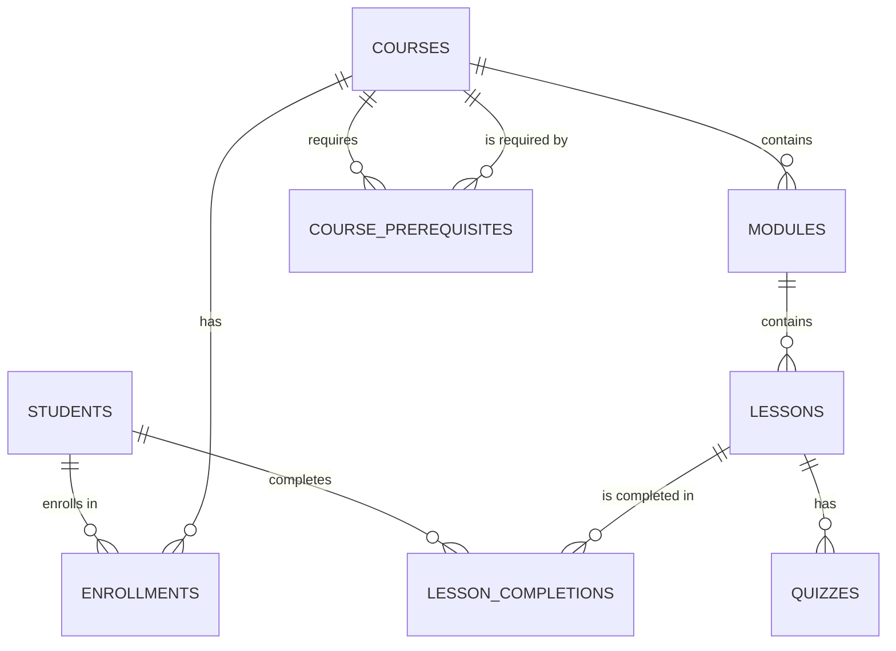

# Online Learning Platform Data Service

Backend data service for an online learning platform. It stores students,
courses, modules, lessons and enrollments in a normalized PostgreSQL schema,
handles enrollment as an atomic transaction with a prerequisite check, tracks
lesson progress, and powers a student dashboard with optimized queries.

| Storage | Used for |
|---|---|
| PostgreSQL | Students, courses, modules, lessons, enrollments, progress |
| PostgreSQL JSONB | Quiz content |
| Redis | Cached course completion percentage per student |
| MongoDB | Forum discussion threads |

## Requirements

- Python 3.11+
- [Poetry](https://python-poetry.org/)
- [Docker Desktop](https://www.docker.com/products/docker-desktop/)

## Setup

```bash
poetry install
docker compose up -d
docker compose exec postgres psql -U postgres -c "CREATE DATABASE learning_platform_test;"
poetry run python scripts/setup_db.py
```

`docker compose up -d` starts PostgreSQL (port 5440), Redis (6379) and
MongoDB (27017). PostgreSQL uses port 5440 on the host so it does not clash
with a locally installed PostgreSQL. `setup_db.py` creates the tables and loads
the sample data: 4 courses, 80 lessons, 5,000 students, 10,000 enrollments and
about 100,000 lesson completions.

## Usage

```bash
poetry run python main.py                     # demo of every feature
poetry run python scripts/explain_dashboard.py  # EXPLAIN ANALYZE of the dashboard query
poetry run python scripts/add_indexes.py      # add the performance index
poetry run pytest                             # run the tests
```

## Project structure

```
sql/
    schema.sql      Tables (3NF)
    seed.sql        Sample data
    indexes.sql     Performance index
src/learning_platform/
    db.py           psycopg2 connection pool
    enrollment.py   Transactional enrollment with prerequisite check
    progress.py     Lesson completion, dashboard, LAG timing, recent activity
    quizzes.py      Quizzes in JSONB
    cache.py        Redis cache of completion percentages
    forum.py        Forum threads in MongoDB
scripts/
    setup_db.py         Create and seed the database
    explain_dashboard.py  EXPLAIN ANALYZE of the recent activity query
    add_indexes.py      Add the performance index
docs/er_diagram.md  ER diagram
tests/              pytest test suite
main.py             Demo
```

## Database design

The schema is in Third Normal Form: every table describes one thing, and
every column depends only on its table's key.

- `lessons` stores `module_id` but not `course_id`. The course is found
  through the module, so storing it again would duplicate a fact.
- Prerequisites are a many-to-many relationship between courses, stored in the
  junction table `course_prerequisites`.
- Completion percentage is not stored in a column. It is calculated from
  `lesson_completions`, so it can never disagree with the real data. Redis only
  holds a temporary cached copy.



The full diagram, with every column, is in [docs/er_diagram.md](docs/er_diagram.md).

## Transactional enrollment

`enroll_student` runs inside one transaction (`with conn:`):

1. Check that every prerequisite course is 100% complete.
2. Insert the enrollment.

If a prerequisite is missing, `PrerequisiteNotMetError` is raised. If the
student is already enrolled, the `UNIQUE (student_id, course_id)` constraint
rejects the insert and `AlreadyEnrolledError` is raised. Either error rolls the
transaction back, so nothing is saved. Letting the database enforce uniqueness
also prevents duplicates when two requests arrive at the same moment.

Connections come from a `psycopg2` `SimpleConnectionPool`, which keeps
connections open and reuses them instead of opening a new one per request.

## Progress calculations

**Completion percentage** joins a course's lessons to the student's
completions with a `LEFT JOIN`. `COUNT(l.lesson_id)` counts every lesson,
while `COUNT(lc.lesson_id)` skips `NULL`s and so counts only completed ones:

```
completion % = completed lessons × 100.0 / total lessons
```

**Dashboard (GROUP BY + subquery)** calculates this for every enrolled course
in one query. A subquery finds the student's enrolled courses, and
`GROUP BY c.course_id` produces one row per course.

**Lesson timing (LAG)** uses the window function
`LAG(completed_at) OVER (ORDER BY completed_at)` to read the previous
completion's time, so `completed_at - LAG(...)` is the time between lessons.

**Completing a lesson** checks the student is enrolled in the lesson's course,
then inserts with `ON CONFLICT DO NOTHING`, so completing it twice keeps the
original time.

## SQL and NoSQL integration

- **JSONB quizzes:** each quiz is one JSON document in `quizzes.content`. The
  `->` operator reads one key inside PostgreSQL:
  `SELECT content -> 'questions' ...`
- **Redis cache:** `get_cached_completion` returns the percentage from Redis if
  it is cached. Otherwise it calculates it in PostgreSQL and stores it under
  `progress:<student_id>:<course_id>` for 5 minutes. `clear_cached_completion`
  deletes it after a lesson is completed.
- **MongoDB forum:** each thread is a document in the `forum_threads`
  collection, linked to PostgreSQL by `course_id` and `student_id`.

## Optimization results

`scripts/explain_dashboard.py` runs `EXPLAIN ANALYZE` on the dashboard's
recent activity query (a student's latest completed lessons, newest first).

The primary key of `lesson_completions` is `(lesson_id, student_id)`. It starts
with `lesson_id`, so it cannot be used to find rows by `student_id` alone.
Before the index, PostgreSQL scanned the whole table:

| | Plan | Rows read | Execution time |
|---|---|---|---|
| Before | Seq Scan + Sort (99,926 rows removed by filter) | ~100,000 | 6.80 ms |
| After | Index Scan Backward on `idx_lesson_completions_student_time` | 5 | 0.07 ms |

The index `(student_id, completed_at)` lets PostgreSQL jump straight to one
student's rows, already in time order. Reading it backwards gives newest first
without sorting, and `LIMIT` stops after 5 rows: about 100× faster, and the
time no longer grows with the size of the table.

The GROUP BY dashboard query was already fast (under 1 ms) without new
indexes: it looks up each `(lesson_id, student_id)` pair in the primary key
index, so no extra index was added for it.

## Tests

28 tests. Tests that need PostgreSQL use a separate database,
`learning_platform_test`, which is rebuilt before every test. Redis and MongoDB
tests use in-memory fakes (`fakeredis`, `mongomock`).

- **Enrollment** (`test_enrollment.py`): enrollment without prerequisites,
  duplicates rejected, missing or partly completed prerequisites rejected with
  nothing saved, other students' progress not counted, connection usable after
  a rollback, completion percentage 0% / 50% / 100%
- **Progress** (`test_progress.py`): completing lessons, enrollment required,
  dashboard values per course, LAG timing, recent activity order and limit
- **NoSQL** (`test_nosql.py`): JSONB quiz round trip, cache miss, hit,
  clearing and expiry, forum threads per course